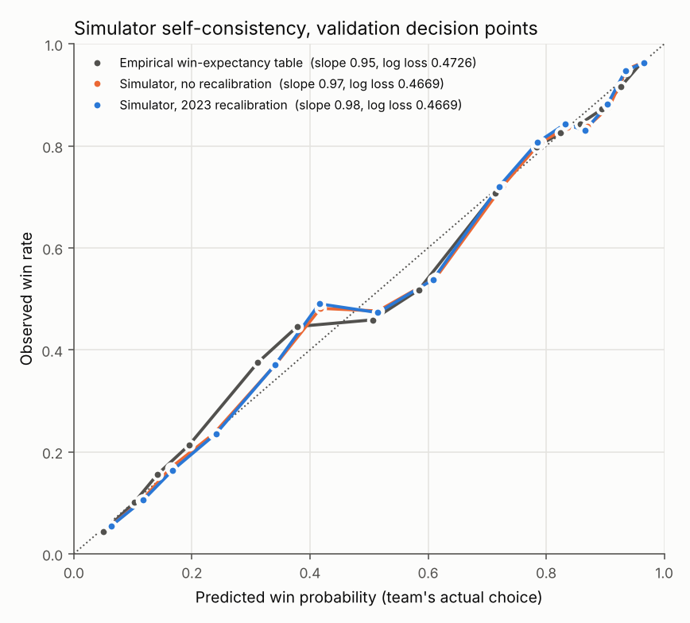

# bullpen-decision-analytics
*A Python-based baseball analytics model to evaluate optimal bullpen deployment.*

## Overview

**Central Question:** When should a baseball manager deploy their highest-rated available reliever, rather than save that pitcher for a later situation?

This project studies late-inning bullpen deployment using historical MLB play-by-play data. It develops a predictive model of game outcomes and uses simulation to compare alternative reliever deployment strategies.

The objective is to estimate how the choice of reliever affects win probability under explicitly stated assumptions—not to claim that historical associations prove a strategy causes better outcomes.

## Research Questions

1. How accurately can historical game states predict win probability?
2. Does incorporating pitcher-specific information improve predictions over a game-state-only baseline?
3. Under the simulation assumptions, which game situations favor using the highest-rated available reliever immediately versus saving them?

## Key Findings

Results below are from the 2023 validation season, which was held out of all model fitting. Then, the 2024-2025 test seasons will be evaluated once after validation.

**Predictive performance:** For the team's actual reliever choice at 2023 decision points, the simulator's win probabilities beat an empirical win-expectancy table built from game state alone (log loss 0.4669 vs 0.4726; difference −0.0057, 95% CI −0.0082 to −0.0032) and are well calibrated (slope 0.98). For run scoring in the rest of the half-inning, a game-state logistic regression beats per-state averages, and adding pitcher quality improves it further across 80,901 relief-pitcher states (log loss −0.00051, 95% CI −0.00085 to −0.00015). On the 6,908 decision points alone, the pitcher-feature gain is too small to separate from noise (−0.00030, 95% CI −0.00102 to +0.00046).
**Strategic insight:** Using the best available reliever now beat saving him for a later high-leverage spot by **+0.11 percentage points** of win probability on average (95% CI +0.10 to +0.14, including model-parameter uncertainty). That is about one extra win per 900 such decisions, roughly a quarter of a win per team per season. The advantage is concentrated in the 9th inning (+0.31 pp), with a 1-run lead (+0.24 pp), and when the best reliever is much better than the next option (+0.20 pp). In the 7th inning (+0.02 pp), or when the top two relievers are rated similarly (+0.02 pp), the choice barely matters.
**Robustness:** The estimate is positive in every pre-specified subgroup and under every assumption test, ranging from +0.105 to +0.174 pp. The tests change the rule for when the saved reliever returns, use stricter and looser availability rules, turn the recalibration off, drop the shortened 2020 season, and give the opponent a stronger bullpen. A placebo without pitcher features gives exactly zero, as it should. Whether the result holds across seasons will be known after the 2024–2025 test run.

## Data

**Primary source:** [Retrosheet](https://www.retrosheet.org/) play-by-play and game-information files ([CSV downloads](https://www.retrosheet.org/downloads/csvdownloads.html)).
* **Seasons analyzed:** 2014–2025 regular seasons. 2014–2015 supply prior-season pitcher history only; models are trained on 2016–2022, validated on 2023 and tested once on 2024–2025.
**Unit of analysis:** A decision point: a relief pitcher entering the game. For the predictive models, an observation is the game state before each play with a reliever on the mound.
**Sample selection:** Regular-season pitching changes in innings 7–9 of games scheduled for nine innings, with the fielding team trailing by up to 2 or leading by up to 3, in games not ending tied, and with at least two relievers available under the rest rule. That gives 64,426 decision points: 43,588 train, 6,908 validation and 13,930 test.
**Target variable:** Whether the batting team scores at least one run from the current state to the end of the half-inning (predictive model). The number of runs (0 / 1 / 2 / 3+) drives the simulator, and the fielding team's win is the outcome it predicts. The strategy estimand is ΔWP = P(win | best reliever now) − P(win | save him).
**Limitations:** No pitch counts, injury or warm-up information. Availability is approximated by a transparent rest rule, which marks 3.4% of the relievers who actually entered at decision points as unavailable. Pitcher quality is run-value based (RE24) and includes defense and sequencing noise, and the data cover regular seasons only.

See [`DATA.md`](DATA.md) for data sources, processing decisions, and the data dictionary.

## Methodology

1. Reconstruct game states from historical play-by-play data.
2. Define pitcher quality and a transparent rule for reliever availability.
3. Fit a baseline predictive model using game-state features.
4. Evaluate whether pitcher-specific features improve predictions.
5. Simulate competing bullpen strategies and estimate their differences in win probability.
6. Quantify uncertainty and test sensitivity to key assumptions.

## Model Evaluation

Metrics include log loss (primary), Brier score, calibration intercept and slope, expected calibration error and reliability plots. Every metric and every model-versus-model difference has a 95% interval from a game-clustered bootstrap (1,000 resamples of games). Strategy comparisons include the mean ΔWP across decision points with intervals from game resampling and from run-model refits on resampled training data. They also include Monte Carlo error, pre-specified subgroups (inning, score, base state, rating gap, home/away), assumption tests, and a placebo check that must return zero.

See [`REPORT.md`](REPORT.md) for the full evaluation and interpretation.

## Results

**Run-scoring model calibration.** Predicted vs observed probability that a run scores in the rest of the half-inning. All three models track the diagonal across all relief states (left). On decision points (right) the per-state baseline M0 over-predicts, because it ignores inning and score; the logistic models correct this.

**Win-probability calibration.** The simulator, run on each team's actual choice, predicts realised wins slightly better than a win-expectancy table built from inning, score and home/away. Both are well calibrated.

**Value of using the best reliever now, by situation.** Thick bars show game-resampling intervals; thin bars add model-parameter uncertainty. Every subgroup is positive, but the size varies about fifteen-fold. It is largest in the 9th inning, with a 1-run lead and when the rating gap between the top two relievers is large. In the 9th the saved reliever can return only in extra innings, so "save him" mostly means not using him at all.

**Inning × score** The 9th-inning 1-run lead (+0.74 pp) and 2–3-run lead (+0.36 pp) drive most of the average. In the 7th and 8th innings the difference is at most +0.07 pp, and in the 7th with a 1-run lead it is zero.

## Limitations

* Training data (2016–2022) predate MLB’s 2023 rule changes, which raised run scoring. A recalibration fitted on 2023 corrects the overall scoring level, and the comparison between strategies barely changes without it (+0.112 vs +0.105 pp).
* Public data may not capture true bullpen availability, injuries, warm-up status, or manager-specific information.
* Simulated strategy outcomes depend on the assumptions used to estimate alternative outcomes.
* Results are estimates from this study, not evidence of a proven causal effect.

## Repository Structure

* `src/` — reusable data-processing, modeling, simulation, and evaluation code
* `notebooks/` — exploratory analysis and diagnostics
* `tests/` — tests for key functions
* `reports/figures/` — final figures
* `DATA.md` — sources and data dictionary
* `REPORT.md` — full research report
* `configs/` — analysis settings (default and availability-sensitivity configurations)

## Author

Sonia Gupta
