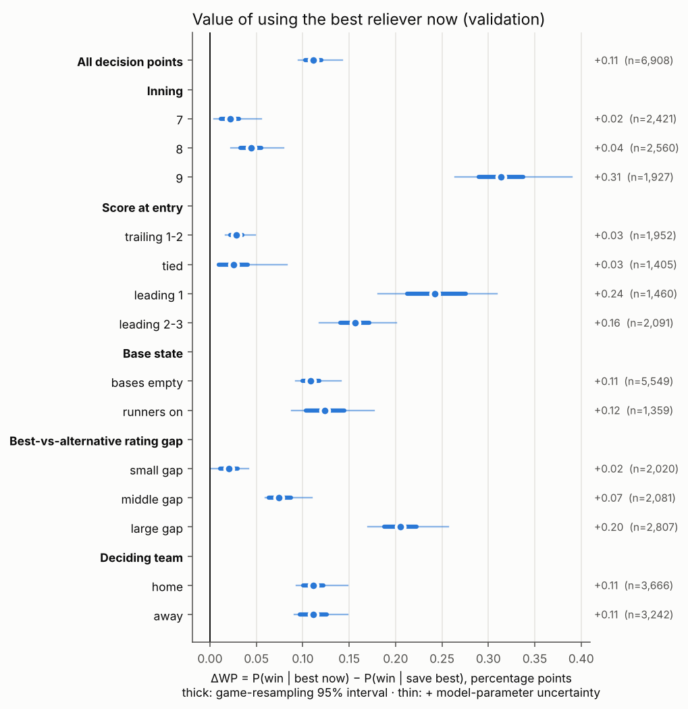
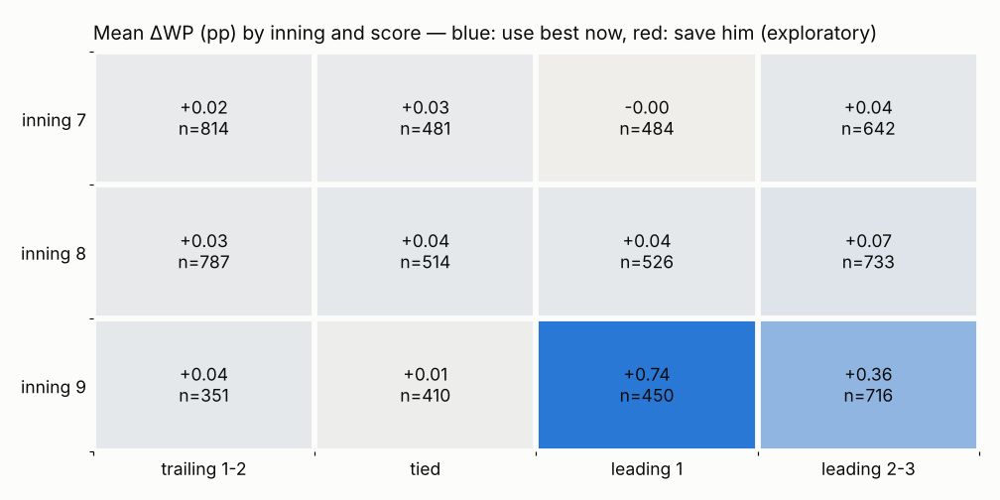

# Decision simulation: best reliever now vs save him (validation)

6,908 decision points in 1,744 games. Primary run model: M2 with 2023 class-intercept recalibration. Intervals: 1000-resample game-clustered bootstrap; 'combined' adds run-model parameter uncertainty from 40 refits on game-bootstrap resamples of 2016–2022.

## Headline

| Quantity | Value |
|---|---|
| Mean ΔWP = P(win \| A) − P(win \| B) | **+0.112 pp** |
| 95% interval, game resampling | [+0.103, +0.120] pp |
| 95% interval, combined with parameter uncertainty | [+0.095, +0.142] pp |
| Monte Carlo SE of the mean | 0.0022 pp |
| Monte Carlo SE per decision point (median / max) | 0.150 / 0.504 pp |
| Share of decision points with ΔWP > 0 | 52.3% |
| Mean simulated WP: A / B / team's actual choice / observed | 0.5668 / 0.5657 / 0.5653 / 0.5618 |

## ΔWP by pre-specified subgroup

| Subgroup | n | Mean ΔWP (pp) | 95% CI, games | 95% CI, combined | MC SE (pp) |
|---|---|---|---|---|---|
| Inning: 7 | 2,421 | +0.022 | [+0.012, +0.031] | [+0.004, +0.055] | 0.0036 |
| Inning: 8 | 2,560 | +0.044 | [+0.033, +0.055] | [+0.023, +0.079] | 0.0037 |
| Inning: 9 | 1,927 | +0.314 | [+0.290, +0.338] | [+0.264, +0.390] | 0.0043 |
| Score at entry: trailing 1-2 | 1,952 | +0.028 | [+0.022, +0.035] | [+0.016, +0.049] | 0.0026 |
| Score at entry: tied | 1,405 | +0.025 | [+0.009, +0.041] | [+0.012, +0.083] | 0.0058 |
| Score at entry: leading 1 | 1,460 | +0.242 | [+0.212, +0.276] | [+0.181, +0.309] | 0.0061 |
| Score at entry: leading 2-3 | 2,091 | +0.156 | [+0.140, +0.171] | [+0.118, +0.201] | 0.0038 |
| Base state: bases empty | 5,549 | +0.109 | [+0.100, +0.118] | [+0.093, +0.141] | 0.0025 |
| Base state: runners on | 1,359 | +0.124 | [+0.103, +0.144] | [+0.088, +0.177] | 0.0051 |
| Best-vs-alternative rating gap: small gap | 2,020 | +0.020 | [+0.011, +0.030] | [+0.000, +0.042] | 0.0028 |
| Best-vs-alternative rating gap: middle gap | 2,081 | +0.074 | [+0.063, +0.087] | [+0.060, +0.110] | 0.0033 |
| Best-vs-alternative rating gap: large gap | 2,807 | +0.205 | [+0.188, +0.223] | [+0.170, +0.257] | 0.0044 |
| Deciding team: home | 3,666 | +0.112 | [+0.100, +0.123] | [+0.093, +0.148] | 0.0029 |
| Deciding team: away | 3,242 | +0.112 | [+0.097, +0.126] | [+0.091, +0.148] | 0.0034 |

Rating-gap tercile cut points come from training decision points: 0.35 and 0.92 runs saved per 100 BF.

### Inning × score (exploratory, not pre-specified)

## Simulator self-consistency (team's actual choice vs realised wins)

| Run model | Predictor | Log loss | Brier | Cal. intercept | Cal. slope | ECE |
|---|---|---|---|---|---|---|
| — | WE0_table | 0.4726 [0.4490, 0.4946] | 0.1539 [0.1447, 0.1623] | 0.0003 [-0.0412, 0.0397] | 0.9477 [0.8819, 1.0232] | 0.0240 |
| recal | SIM_actual | 0.4669 [0.4443, 0.4886] | 0.1518 [0.1428, 0.1603] | -0.0234 [-0.0624, 0.0147] | 0.9849 [0.9175, 1.0653] | 0.0234 |
| recal | SIM − WE0 log loss | -0.00569 [-0.00815, -0.00315] | | | | |
| no_recal | SIM_actual | 0.4669 [0.4441, 0.4890] | 0.1518 [0.1428, 0.1603] | -0.0325 [-0.0719, 0.0057] | 0.9718 [0.9054, 1.0504] | 0.0219 |
| no_recal | SIM − WE0 log loss | -0.00565 [-0.00797, -0.00323] | | | | |

WE0_table: training win rate by inning × home × margin at the decision point (add-one smoothed).

## Run-distribution model (Y1b: 0 / 1 / 2 / 3+ runs, rest of half-inning)

80,901 validation relief states, 2,429 games. Observed shares [0.72559, 0.13823, 0.07072, 0.06546].

| Model | Log loss | RPS | Mean predicted shares |
|---|---|---|---|
| M0 | 0.7948 [0.7827, 0.8070] | 0.1120 | [0.72804, 0.13686, 0.06953, 0.06557] |
| M1 | 0.7934 [0.7807, 0.8055] | 0.1118 | [0.73062, 0.13502, 0.0699, 0.06446] |
| M2 | 0.7930 [0.7803, 0.8054] | 0.1117 | [0.73268, 0.13483, 0.06894, 0.06355] |

| Comparison | Δ log loss | 95% CI | Share of resamples not better |
|---|---|---|---|
| M1-M0 | -0.00131 | [-0.00214, -0.00049] | 0.000 |
| M2-M1 | -0.00045 | [-0.00092, +0.00002] | 0.031 |

2023 recalibration offsets (classes 1, 2, 3+ vs 0): [0.0401, 0.041, 0.0473]; predicted shares after recalibration [0.72559, 0.13823, 0.07072, 0.06546].

## Parameter uncertainty

Mean ΔWP across 40 refits (400 simulations each): SD 0.010 pp, 2.5–97.5% range [+0.098, +0.135] pp. Combined with game resampling: [+0.095, +0.142] pp (share ≤ 0: 0.000).

## Assumption tests

| Variant | n | Mean ΔWP (pp) | 95% CI, games | What changes |
|---|---|---|---|---|
| **Primary** | 6,908 | +0.112 | [+0.103, +0.120] | — |
| recalibration: no_recal | 6,908 | +0.105 | [+0.096, +0.113] | the other recalibration option |
| reserve rule: save_only | 6,908 | +0.174 | [+0.163, +0.185] | held reliever enters first later half-inning with inning >= 9 and T margin 1..3 |
| reserve rule: late_close | 6,908 | +0.157 | [+0.146, +0.167] | held reliever enters first later half-inning with inning >= 8 and T margin -1..1 |
| training without 2020 | 6,908 | +0.109 | [+0.098, +0.118] | run model refit without the 60-game season |
| strong opponent bullpen | 6,908 | +0.110 | [+0.100, +0.119] | every opponent reliever rated 1 run saved per 100 BF better than the training average |
| placebo: no pitcher features (M1) | 6,908 | +0.000 | [+0.000, +0.000] | must be exactly 0: strategies differ only by pitcher |
| availability: strict | 6,840 | +0.123 | [+0.111, +0.133] | decisions rebuilt with configs/sensitivity_strict.json |
| availability: lenient | 6,909 | +0.105 | [+0.096, +0.115] | decisions rebuilt with configs/sensitivity_lenient.json |

## Descriptive only (confounded by manager choice)

| Team actually used | Realised win rate | n |
|---|---|---|
| best | 0.712 | 1,567 |
| other_available | 0.480 | 3,903 |
| rule_unavailable | 0.721 | 136 |
| second | 0.610 | 1,302 |

## Reading this

- ΔWP > 0 favours using the best available reliever now; ΔWP < 0 favours saving him under the pre-specified reserve rule.
- The simulator works at the half-inning level: each reliever pitches the rest of the half-inning he starts; the opponent's pitcher is the average training reliever for its current margin; base-out state is reset each half-inning.
- In the 9th, B's reserve can only appear in extra innings (the next half-inning starting in inning 8+ with T tied or ahead), so most of the 9th-inning ΔWP is 'use the best reliever rather than not at all'.
- Effect sizes are bounded by how much the shrunk RE24 rating predicts runs (Y1b M2 − M1 is small). If true talent gaps are larger than the rating gaps, ΔWP is understated (SPEC §4.4); the combined interval covers parameter noise, not that kind of misspecification.
- The answer is "best now vs this specific save policy" (SPEC §4.4), with availability approximated by the rest rule.
