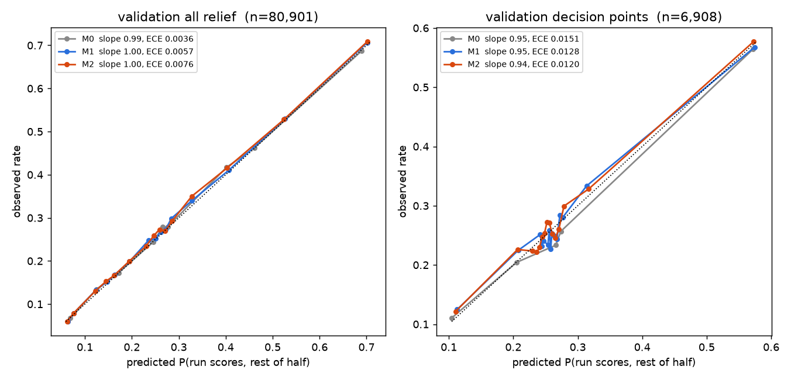

# Y1 model ladder: run scores in rest of half-inning

Built 2026-10-22 14:51. Fit on training seasons [2016, 2017, 2018, 2019, 2020, 2021, 2022] (relief states, n=492,753); scored on validation [2023]. 95% intervals from a 1000-resample game-clustered bootstrap. Test seasons were not loaded.

## validation all relief

80,901 states in 2,429 games; observed rate 0.2744.

| Model | Log loss | Brier | Cal. intercept | Cal. slope | ECE | Mean pred |
|---|---|---|---|---|---|---|
| M0 | 0.5176 [0.5114, 0.5236] | 0.1709 [0.1683, 0.1734] | 0.0144 [-0.0163, 0.0470] | 0.9946 [0.9662, 1.0226] | 0.0036 | 0.2720 |
| M1 | 0.5170 [0.5107, 0.5230] | 0.1707 [0.1680, 0.1731] | 0.0308 [0.0008, 0.0627] | 0.9955 [0.9673, 1.0239] | 0.0057 | 0.2692 |
| M2 | 0.5165 [0.5103, 0.5227] | 0.1705 [0.1678, 0.1730] | 0.0420 [0.0118, 0.0739] | 0.9985 [0.9703, 1.0269] | 0.0076 | 0.2673 |

| Comparison | Δ log loss | 95% CI | Share of resamples not better |
|---|---|---|---|
| M1-M0 | -0.00062 | [-0.00109, -0.00014] | 0.005 |
| M2-M1 | -0.00051 | [-0.00085, -0.00015] | 0.004 |

## validation decision points

6,908 states in 1,744 games; observed rate 0.2687.

| Model | Log loss | Brier | Cal. intercept | Cal. slope | ECE | Mean pred |
|---|---|---|---|---|---|---|
| M0 | 0.5610 [0.5500, 0.5718] | 0.1876 [0.1827, 0.1923] | -0.0764 [-0.1334, -0.0229] | 0.9492 [0.8360, 1.0668] | 0.0151 | 0.2832 |
| M1 | 0.5602 [0.5486, 0.5716] | 0.1873 [0.1822, 0.1921] | -0.0138 [-0.0710, 0.0398] | 0.9484 [0.8388, 1.0697] | 0.0128 | 0.2713 |
| M2 | 0.5599 [0.5479, 0.5714] | 0.1872 [0.1820, 0.1922] | 0.0142 [-0.0424, 0.0673] | 0.9431 [0.8333, 1.0616] | 0.0120 | 0.2660 |

| Comparison | Δ log loss | 95% CI | Share of resamples not better |
|---|---|---|---|
| M1-M0 | -0.00085 | [-0.00172, +0.00011] | 0.039 |
| M2-M1 | -0.00030 | [-0.00102, +0.00046] | 0.227 |

## train all relief

492,753 states in 15,464 games; observed rate 0.2675.

| Model | Log loss | Brier | Cal. intercept | Cal. slope | ECE | Mean pred |
|---|---|---|---|---|---|---|
| M0 | 0.5122 | 0.1685 | 0.0000 | 1.0000 | 0.0000 | 0.2675 |
| M1 | 0.5115 | 0.1682 | 0.0004 | 0.9989 | 0.0020 | 0.2674 |
| M2 | 0.5111 | 0.1681 | 0.0001 | 0.9996 | 0.0024 | 0.2675 |

| Comparison | Δ log loss | 95% CI | Share of resamples not better |
|---|---|---|---|
| M1-M0 | -0.00070 | — | — |
| M2-M1 | -0.00039 | — | — |

## train decision points

43,588 states in 10,796 games; observed rate 0.2719.

| Model | Log loss | Brier | Cal. intercept | Cal. slope | ECE | Mean pred |
|---|---|---|---|---|---|---|
| M0 | 0.5594 | 0.1871 | -0.0644 | 0.9882 | 0.0132 | 0.2841 |
| M1 | 0.5585 | 0.1867 | -0.0153 | 0.9916 | 0.0067 | 0.2748 |
| M2 | 0.5582 | 0.1866 | -0.0030 | 0.9861 | 0.0060 | 0.2725 |

| Comparison | Δ log loss | 95% CI | Share of resamples not better |
|---|---|---|---|
| M1-M0 | -0.00093 | — | — |
| M2-M1 | -0.00032 | — | — |

## M2 non-game-state coefficients

| Feature | Odds ratio per unit | Coef (standardised) |
|---|---|---|
| fld_is_home | 0.9331 | -0.0346 |
| extra_runner_era | 0.9667 | -0.0165 |
| pitcher_runs_saved_per100 | 0.9521 | -0.0588 |
| log_rating_eff_bf | 0.9688 | -0.0350 |
| pitched_d1 | 0.9726 | -0.0100 |
| pitched_d2 | 1.0291 | +0.0126 |
| bf_d1 | 1.0140 | +0.0199 |
| apps_prev4 | 1.0003 | +0.0003 |
| pitcher_bf_in_game | 1.0064 | +0.0165 |

